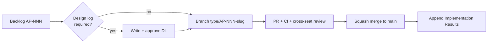

# 0001 — Project Foundation & Delivery Setup

| | |
|---|---|
| Status | Approved — 2026-10-31 (TL/Fikri). Phase 1 done; Phases 2–4 in progress |
| Author | TL seat |
| Task | `AP-001` |
| Created | 2026-10-31 |
| Reviewers | BE, MOB-A, MOB-B, WEB, QA |

## Decisions for the Implementer (TL;DR)

- **D1 — Monorepo.** One repo, four top-level work areas: `apps/mobile`, `apps/admin`,
  `supabase/`, `docs/` + `design-log/`.
- **D2 — Stack is locked to the PRD.** Flutter + Riverpod + `flutter_map`; Supabase
  (Postgres/PostGIS, Auth, Storage, Realtime, Edge Functions, pg_cron); FCM HTTP v1 from an
  Edge Function; React + Vite + TypeScript for admin. Do not introduce a competing state,
  map, or backend library without a new design log.
- **D3 — Android first.** iOS stays buildable but is not a release gate before the
  competition. See PRD open question 1 (`docs/PRD-ApiPantau.md:477`).
- **D4 — Fast-moving trunk.** `main` is always demo-able. Feature branches live < 3 days,
  one reviewer from a different seat, squash merge.
- **D5 — Design log is a gate, not documentation.** Any `M`/`L` task, schema change, auth
  change, or notification change needs an approved log before code. `S` tasks may skip it
  but still update the backlog and append results to the parent log.
- **D6 — Secrets never reach a client.** NASA FIRMS `MAP_KEY`, FCM service account, and
  Supabase service-role key exist only in Edge Function env / CI secrets.
- **D7 — Naming.** App name `ApiPantau`; package/bundle id `id.clubcoding.apipantau`;
  task IDs `AP-NNN`; design logs `NNNN-kebab-title.md`; branches `type/AP-NNN-slug`.

## Background

The repo holds one product document (`docs/PRD-ApiPantau.md`) and nothing else. The PRD
already fixes the product scope, MVP features, stack recommendation, data model sketch, and
a 5-week milestone plan (`docs/PRD-ApiPantau.md:436`). What is missing is the engineering
contract: where code lives, how environments are separated, who owns what, and how a task
travels from backlog to merged code.

## Problem

Six people working in parallel on a greenfield Flutter + Supabase product will collide on
schema, env vars, and conventions within the first week unless those are written down once.
The cost of deciding late is rework during the M5 demo freeze.

## Prior Art / Adjacent Mechanisms

| Mechanism | Where | Verdict |
|---|---|---|
| PRD (product intent, features, KPIs) | `docs/PRD-ApiPantau.md` | Authoritative for *what*; says nothing about repo/delivery |
| Design-log methodology | `AGENTS.md`, `.cursor/rules/design-log.mdc` | Adopted as the design gate (D5) |
| Supabase built-ins: Auth, RLS, Storage, Realtime, pg_cron | PRD §11 `docs/PRD-ApiPantau.md:354` | Reused instead of custom auth/storage/cron services |
| `flutter_map` + OSM/Esri tiles | PRD §10.1 `docs/PRD-ApiPantau.md:322` | Reused; no Google Maps key or billing |
| Backlog + team charter | `docs/BACKLOG.md`, `docs/TEAM.md` | Owns scheduling/ownership; this log owns technical setup |

**Null hypothesis:** could the PRD alone serve as the engineering spec? No — it does not
name branches, envs, package ids, quality gates, or the review flow, and it mixes P1/P2
scope. Those gaps are what this log closes; anything product-facing stays in the PRD.

## Questions and Answers

**Q1 — Monorepo or one repo per app?**
A1 — Monorepo. The competition timeline (`docs/PRD-ApiPantau.md:436`) rewards atomic
changes: a schema migration plus the mobile model plus the admin query land in one PR.
Flutter and Node toolchains coexist fine at `apps/mobile` and `apps/admin`. Split later only
if CI time becomes painful.

**Q2 — Android first, or both platforms?**
A2 — Android first (D3). The PRD persona uses mid-range Android phones, the APK size budget
is Android-specific (`docs/PRD-ApiPantau.md:271`), and field testing needs sideloading. iOS
builds stay green in CI but ship after the competition.

**Q3 — What is the package / bundle id?**
A3 — `id.clubcoding.apipantau`. It matches the org name, is stable across renames of the
display name, and can be changed once before any store submission. Not worth a design log
to change later, but do it before M5.

**Q4 — Admin: Next.js or plain Vite SPA?**
A4 — Vite + React + TypeScript. The dashboard is authenticated, internal, and has no SEO or
SSR requirement; a static SPA on any static host is cheaper to operate and simpler for the
WEB seat. Supabase JS + TanStack Query + Recharts cover data, caching, and charts.

**Q5 — Where do shared types live?**
A5 — `supabase/functions/_shared/types.ts` for Edge Functions, handwritten Dart models in
`apps/mobile/lib/data/models/`, and `apps/admin/src/lib/database.types.ts` generated from
the schema with `supabase gen types typescript`. No custom codegen pipeline in M1; revisit
if drift causes bugs.

**Q6 — How are environments separated?**
A6 — Three: local (`supabase start`, seeded), `staging` (Supabase project, used for the
demo rehearsal), `prod` (only if a pilot happens). Mobile selects the backend with
`--dart-define=SUPABASE_URL=...` / `--dart-define=SUPABASE_ANON_KEY=...`; no hardcoded URLs.
Edge Function secrets are set per project, never committed.

**Q7 — Does every task need a design log?**
A7 — No. `S` (≤ 1 day) tasks append to the parent epic log. `M`/`L` tasks, and anything
touching schema, RLS, auth, ingest, or notifications, require their own approved log (D5).

**Q8 — Which quality gates block a merge?**
A8 — Mobile: `dart format --set-exit-if-changed`, `flutter analyze`, `flutter test`.
Admin: `tsc --noEmit`, `eslint`, `vitest` (once tests exist). Schema: migrations apply
cleanly on a fresh local DB. All gates run in CI (`AP-007`).

**Q9 — How do we handle the PRD's open questions (name, verifier, pilot)?**
A9 — Track them as decisions in `docs/BACKLOG.md` under "Open decisions", not as code
assumptions. Name stays `ApiPantau` until the pitch deck freezes; verifier for the demo is
the team itself (QA + TL), community verifiers are a post-MVP path.

## Design

### Repository layout

```
clubcoding/
├─ apps/
│  ├─ mobile/                 # Flutter app (Android first)
│  │  ├─ lib/
│  │  │  ├─ core/             # theme, router, config, result types
│  │  │  ├─ data/             # supabase client, models, local db (drift)
│  │  │  └─ features/         # auth, map, report, alerts, verify, profile
│  │  └─ test/
│  └─ admin/                  # Vite + React + TS dashboard
│     └─ src/{pages,components,lib}
├─ supabase/
│  ├─ migrations/             # timestamped SQL, RLS in the same migration
│  ├─ functions/              # ingest-firms, notify-incident, classify-photo
│  │  └─ _shared/             # types.ts, supabase client, geo helpers
│  └─ seed.sql                # demo data
├─ docs/                      # PRD, BACKLOG, TEAM
├─ design-log/                # index, template, NNNN logs
└─ AGENTS.md                  # rules for humans and AI agents
```

### Environment matrix

| Concern | Local | Staging | Prod |
|---|---|---|---|
| Database | `supabase start` + `seed.sql` | Supabase project | Supabase project (pilot only) |
| Auth OTP | Mailpit / test numbers | Real SMS provider | Real SMS provider |
| FIRMS ingest | Manual function invoke | Cron every 30 min in season | Cron every 30 min in season |
| FCM | Test device tokens | Test device tokens | Pilot devices |
| Mobile build | debug | internal APK | signed APK (M5) |

### Branch, review, and task flow



- One accountable owner per task; reviewer must be from a different seat.
- WIP limit: 1 in-progress task per person, 1 in-review PR per person.
- Anything not demo-able on `main` at the end of a week is cut or descoped, not merged
  half-done behind a flag.

### Naming and versioning

| Artifact | Convention | Example |
|---|---|---|
| Task | `AP-NNN` | `AP-020` |
| Branch | `feat/AP-020-report-capture` | |
| Commit | Conventional Commits + task id | `feat(mobile): 1-tap report capture (AP-020)` |
| Design log | `NNNN-kebab-title.md` | `0002-data-model-and-rls.md` |
| Migration | `YYYYMMDDHHMMSS_snake_case.sql` | `20261101120000_reports.sql` |
| Edge Function | kebab-case folder | `supabase/functions/ingest-firms/` |

## Implementation Plan

| Phase | Work | Owner | Done when |
|---|---|---|---|
| 1 | Create layout, `.gitignore`, `.env.example`, README, team charter, backlog | TL | PR merged, links resolve |
| 2 | Scaffold Flutter app shell, admin app shell, `supabase init` | MOB-A / WEB / BE | Apps build locally, CI runs |
| 3 | CI gates (analyze, test, tsc, lint) + branch protection on `main` | TL | A red CI blocks merge |
| 4 | First real design logs: data model + RLS (`AP-003`), app shell (`AP-005`), admin (`AP-006`) | BE / MOB-A / WEB | Logs approved, index updated |

## Examples

✅ Branch and commit scoped to one backlog task, result appended to the log:

```
feat/AP-020-report-capture
feat(mobile): 1-tap report capture with offline queue (AP-020)
```

✅ Config injected, never hardcoded:

```dart
const supabaseUrl = String.fromEnvironment('SUPABASE_URL');
```

❌ `lib/main.dart` containing a project URL and anon key — keys rotate, leaks spread.

❌ Opening a PR that adds `hotspots` without RLS "because we will add it later" — the table
would be publicly readable through PostgREST the moment it is deployed.

## Trade-offs

| Option | Pros | Cons | Verdict |
|---|---|---|---|
| Monorepo | Atomic PRs, one CI, shared docs | Slightly larger clone; mixed toolchains | **Chosen** |
| Polyrepo | Independent release cadence | Cross-repo coordination cost, 3 CIs | Rejected for 5-week scope |
| Next.js admin | SSR, routing conventions | Extra server runtime, unused SSR | Rejected |
| Vite SPA admin | Static host, fast CI, small surface | No SSR (not needed) | **Chosen** |
| Design log for every task | Max traceability | Slows `S` tasks | Rejected; threshold in D5 |

## Verification Criteria

- [ ] `apps/mobile`, `apps/admin`, `supabase/`, `docs/`, `design-log/` exist and the app
      shells build locally.
- [ ] `flutter analyze` and `tsc --noEmit` pass on a clean clone; CI enforces both.
- [ ] `main` requires a PR + one cross-seat approval.
- [ ] A new contributor can go from clone to running app using only `README.md`.
- [ ] No secret is committed: `git grep -i "map_key\|service_role"` returns only docs/examples.

## Implementation Results

_Append only after implementation starts. Do not edit the sections above._

### 2026-10-31 — Phase 1 (documentation & delivery setup)

- Delivered: `AGENTS.md`, `.cursor/rules/design-log.mdc`, `design-log/index.md`,
  `design-log/template.md`, this log, `docs/BACKLOG.md` (52 P0 tasks / 89 ideal days),
  `docs/TEAM.md` (6 seats), `.gitignore`, `.env.example`, rewritten `README.md`.
- Scope note: docs and rules landed before app scaffolding because they carry no runtime
  risk and unblock parallel design work. Phases 2–4 (app shells, CI, per-area logs) are not
  started.
- Deviations: none from Phase 1.
- Tests: not applicable (no code); local markdown link check passed — all relative links
  resolve.
- Next: review/approve this log, then `AP-002` (Supabase envs), `AP-003`/`AP-004`
  (schema + RLS, DL-0002), `AP-005` (Flutter shell, DL-0003), `AP-006` (admin shell, DL-0004).

