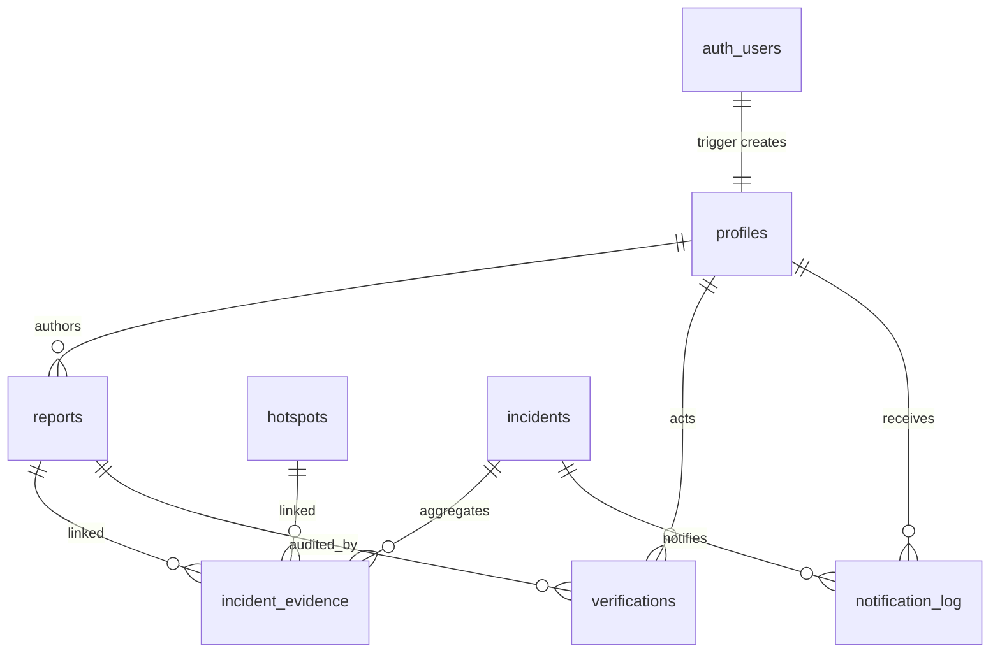
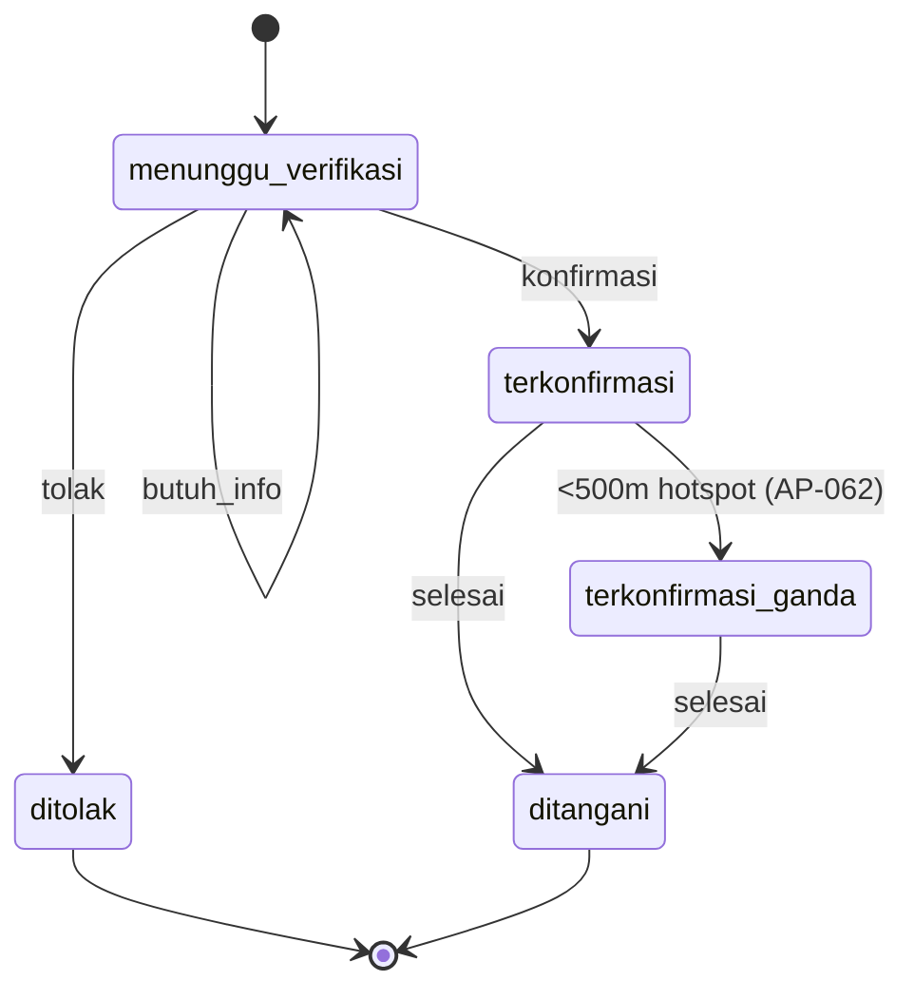

# 0002 — Data Model, PostGIS Schema & RLS

| | |
|---|---|
| Status | Proposed |
| Author | BE seat (Fajri) |
| Task | `AP-003`, `AP-004` |
| Created | 2026-10-31 |
| Reviewers | TL, WEB, MOB-A |

## Decisions for the Implementer (TL;DR)

- **D1 — One migration per concern** under `supabase/migrations/`: extensions/helpers → tables →
  RLS → RPCs → storage. Never edit an applied migration.
- **D2 — Statuses are `text` + `CHECK`, not Postgres enums.** Enums are painful to extend
  (`ALTER TYPE ... ADD VALUE` cannot run in a transaction on older PG versions); CHECKs are
  easy to version and map cleanly to Dart enums.
- **D3 — `profiles.id = auth.users.id`**, created by an `AFTER INSERT` trigger on `auth.users`.
  `role` is `warga | verifikator | admin`; users can never update their own `role`.
- **D4 — Verification is a single RPC**, `verify_report(report_id, action, note)`, not a
  client `PATCH`. It writes `verifications` and updates `reports.status` in one transaction,
  enforcing the state machine server-side.
- **D5 — Map data is readable without login; report authorship is not.** `hotspots` and
  `incidents` are selectable by `anon` (public early warning), reports require authentication,
  and a report's owner sees all of their own reports.
- **D6 — `notification_log` unique key is `(incident_id, user_id, kind)`**, with
  `kind in ('initial','escalation')`, so the 6-hour anti-spam rule does not suppress a genuine
  escalation.
- **D7 — Every table ships RLS in the same PR.** No exceptions, including join tables.
- **Out of scope:** hot-path partitioning, PostGIS clustering schedule (DL-0010), and the
  notification fan-out query (DL-0011).

## Background

The PRD sketches the schema (`docs/PRD-ApiPantau.md:372`) and the geospatial queries the
product depends on (`docs/PRD-ApiPantau.md:412`). The status machines are defined at
`docs/PRD-ApiPantau.md:218` (report) and `docs/PRD-ApiPantau.md:227` (incident). What is not
decided: who may read/write which row, how statuses are constrained, and where verification
logic lives.

## Problem

Six seats will write queries against these tables in parallel. Without a single schema +
RLS source of truth, mobile and admin will disagree on column names and permissions, and a
missing policy silently exposes citizen location data through PostgREST.

## Prior Art / Adjacent Mechanisms

| Mechanism | Where | Verdict |
|---|---|---|
| Schema sketch (tables, columns, indexes) | `docs/PRD-ApiPantau.md:372` | Adopted, with naming/constraint refinements |
| PostGIS distance + bbox + DBSCAN | `docs/PRD-ApiPantau.md:412` | Reused; no custom geo service |
| Supabase Auth + RLS | `docs/PRD-ApiPantau.md:352` | Reused for authorization; no custom auth layer |
| Supabase Storage | `docs/PRD-ApiPantau.md:293` | Reused for photos; private bucket + policies |
| Design Log 0001 | `design-log/0001-project-foundation.md` | Locks stack, env matrix, migration conventions |
| Supabase Studio roles | built-in | Not sufficient: admin UI needs audited, role-scoped reads |

**Null hypothesis:** can we expose `reports` directly to clients and let the app decide who
sees what? No — RLS is the only barrier once an anon key is public. Can we skip
`incident_evidence` and store `incident_id` on reports? That loses the many-to-many evidence
model needed when one incident aggregates several reports and hotspots (PRD §12).

## Questions and Answers

**Q1 — Why `text + CHECK` instead of enums for status/role?**
A1 — Adding `terkonfirmasi_ganda` or a future `arsip` status is a one-line CHECK change;
enum changes are migration-hostile and PostgREST surfaces them identically. Cost: values are
not type-safe at the DB level, so the RPC validates transitions explicitly.

**Q2 — Who can read raw, unconfirmed reports?**
A2 — Authenticated users only, and never `ditolak` unless it is their own. Rationale: raw
reports contain citizen-supplied locations and unverified claims; exposing them anonymously
invites hoax amplification. `hotspots` and `incidents` stay anonymous-readable because they
are the public warning layer.

**Q3 — Why route verification through an RPC rather than an RLS-guarded UPDATE?**
A3 — Three things must happen atomically: authorize the actor, append an immutable audit row,
and transition the report status (including `butuh_info` looping back). RLS can gate an UPDATE
but cannot guarantee the audit row or the transition table. One `SECURITY DEFINER` function
keeps that invariant in one place and is callable from mobile and admin alike.

**Q4 — Should `home_geom` be mandatory?**
A4 — No. Location permission may be denied (`docs/PRD-ApiPantau.md:131`). `home_geom` is
nullable; users without it simply receive no radius push until they set a point.

**Q5 — How is `profile` created for OTP users?**
A5 — Trigger `on_auth_user_created` reads `raw_user_meta_data->>'name'` and `phone`, inserts
`profiles` with role `warga`. Seeding verifiers/admins is a service-role/admin action (`AP-063`).

**Q6 — Do we need `updated_at` columns?**
A6 — Yes on `reports` and `incidents` (dashboard and debugging), maintained by one
`set_updated_at()` trigger. No history table in MVP; `verifications` is the audit trail.

**Q7 — Where do dashboard stats come from?**
A7 — A `SECURITY DEFINER` RPC `dashboard_stats(from, to, region)` returning JSON, admin-only.
It reuses `reports`, `incidents`, `verifications`; no materialized views in MVP.

**Q8 — Storage: public bucket or signed URLs?**
A8 — Private bucket, authenticated read. Photos of fires are evidence, not marketing assets;
EXIF is stripped client-side (`AP-021`) and the object path includes the uploader's uid.

## Design

### Entity relationships



### Tables and constraints

| Table | Key columns | Constraints |
|---|---|---|
| `profiles` | `id uuid PK → auth.users`, `role text`, `home_geom geography(Point,4326)`, `alert_radius_km int` | `role in ('warga','verifikator','admin')`, `alert_radius_km between 1 and 50` |
| `reports` | `geom geography(Point,4326) NOT NULL`, `status text`, `photos text[]`, `ai_label`, `ai_score` | status in the 5 PRD values; `cardinality(photos) between 0 and 3`; `ai_score between 0 and 1` |
| `hotspots` | `geom`, `dedup_key text UNIQUE`, `acq_date`, `confidence` | dedup key NOT NULL; lat/lon rounded in the key |
| `incidents` | `centroid geography(Point,4326)`, `radius_m`, `status`, `confidence` | status in 4 PRD values; `radius_m > 0` |
| `incident_evidence` | `incident_id`, `report_id`, `hotspot_id` | exactly one of report/hotspot is set; unique pair per evidence |
| `verifications` | `report_id`, `actor_id`, `action`, `note` | action in `('konfirmasi','tolak','butuh_info')`; append-only |
| `notification_log` | `incident_id`, `user_id`, `kind`, `fcm_message_id`, `status` | unique `(incident_id,user_id,kind)`; kind in `('initial','escalation')` |

### Report state machine (server-enforced)



`verify_report` only accepts the four legal actions from `menunggu_verifikasi`; all other
transitions are system actions (AP-062, AP-042) and are not callable by clients.

### RLS matrix

| Table | anon | warga | verifikator | admin |
|---|---|---|---|---|
| `hotspots` | SELECT | SELECT | SELECT | SELECT |
| `incidents` | SELECT | SELECT | SELECT | SELECT |
| `incident_evidence` | SELECT | SELECT | SELECT | SELECT |
| `reports` | — | SELECT own + non-rejected; INSERT own; UPDATE own while `menunggu_verifikasi` (note/photo only) | SELECT all; via RPC | SELECT all |
| `profiles` | — | SELECT/UPDATE own (not `role`) | SELECT all | SELECT/UPDATE all |
| `verifications` | — | — | SELECT; INSERT via RPC only | SELECT |
| `notification_log` | — | SELECT own | SELECT own | SELECT all |

Helper functions (all `stable security definer`, `search_path = public`):
`current_role()`, `is_verifier()`, `is_admin()`. Policies call these instead of subselecting
`profiles` (avoids recursive RLS evaluation).

### RPCs

| Function | Args | Returns | Guard |
|---|---|---|---|
| `reports_in_bbox` | `min_lng,min_lat,max_lng,max_lat,status_filter text[]` | report rows | authenticated |
| `hotspots_in_bbox` | bbox + `days int` | hotspot rows | anon allowed |
| `incidents_near` | `lat, lng, radius_km` | incident + `distance_m` | anon allowed |
| `verify_report` | `report_id uuid, action text, note text` | `verifications` row | verifier/admin |
| `dashboard_stats` | `from_date, to_date, region text` | `jsonb` | admin |

### File layout

```
supabase/migrations/
  20261031090000_extensions_and_helpers.sql
  20261031090100_tables.sql
  20261031090200_rls.sql
  20261031090300_rpc.sql
  20261031090400_storage.sql
supabase/seed.sql
```

## Implementation Plan

| Phase | Work | Owner | Done when |
|---|---|---|---|
| 1 | Extensions, helper functions, tables, constraints, indexes | BE | Migration applies on empty DB |
| 2 | RLS policies + Storage bucket policies | BE | Anon key cannot read `reports`/`profiles`; hotspot read works |
| 3 | RPCs (`verify_report`, bbox, near, stats) | BE | `verify_report` writes audit + status atomically |
| 4 | Seed + policy tests (SQL assertions) | BE | `supabase db reset` then seed is idempotent |

## Examples

✅ Verifier action goes through one audited entry point:

```ts
await supabase.rpc('verify_report', {
  p_report_id: id, p_action: 'konfirmasi', p_note: 'Asap tebal, api terlihat',
});
```

❌ Direct patch that skips the audit trail and lets any authenticated user forge a status:

```ts
await supabase.from('reports').update({ status: 'terkonfirmasi' }).eq('id', id);
```

✅ Policy scoped to ownership:

```sql
create policy "reports_select_own" on public.reports
for select to authenticated
using (user_id = (select auth.uid()) and status <> 'ditolak');
```

❌ `using (true)` on `reports` "so the map works" — leaks every citizen report and its location.

## Trade-offs

| Option | Pros | Cons | Verdict |
|---|---|---|---|
| RPC verification | Atomic, auditable, one rulebook | Extra hop; RPC must be versioned | **Chosen** |
| RLS UPDATE + trigger audit | Fewer endpoints | Triggers hide intent; easy to bypass | Rejected |
| Enum statuses | DB-level type safety | Migration friction; rigid | Rejected |
| `text + CHECK` | Easy evolution, Dart-friendly | Validation duplicated in app | **Chosen** |
| Anon-readable reports | Simpler demo map | Privacy + hoax risk | Rejected |
| Anon-readable hotspots/incidents | Public warning value | Some operational data exposed | **Chosen** |

## Verification Criteria

- [ ] `supabase db reset` applies all five migrations on an empty database.
- [ ] `anon` key: `select * from hotspots` returns rows; `select * from reports` returns none.
- [ ] `warga` can insert own report, cannot insert for another `user_id`, cannot change status.
- [ ] `verifikator` calling `verify_report` produces exactly one `verifications` row and the
      expected status; a `warga` calling it gets `insufficient_privilege`.
- [ ] Deleting/altering a `verifications` row is denied for every client role.
- [ ] `notification_log` rejects a duplicate `(incident_id,user_id,kind)` but accepts an
      `escalation` after an `initial`.
- [ ] Photo upload to `report-photos/<other-uid>/x.jpg` is denied.

## Implementation Results

_Append only after implementation starts._
